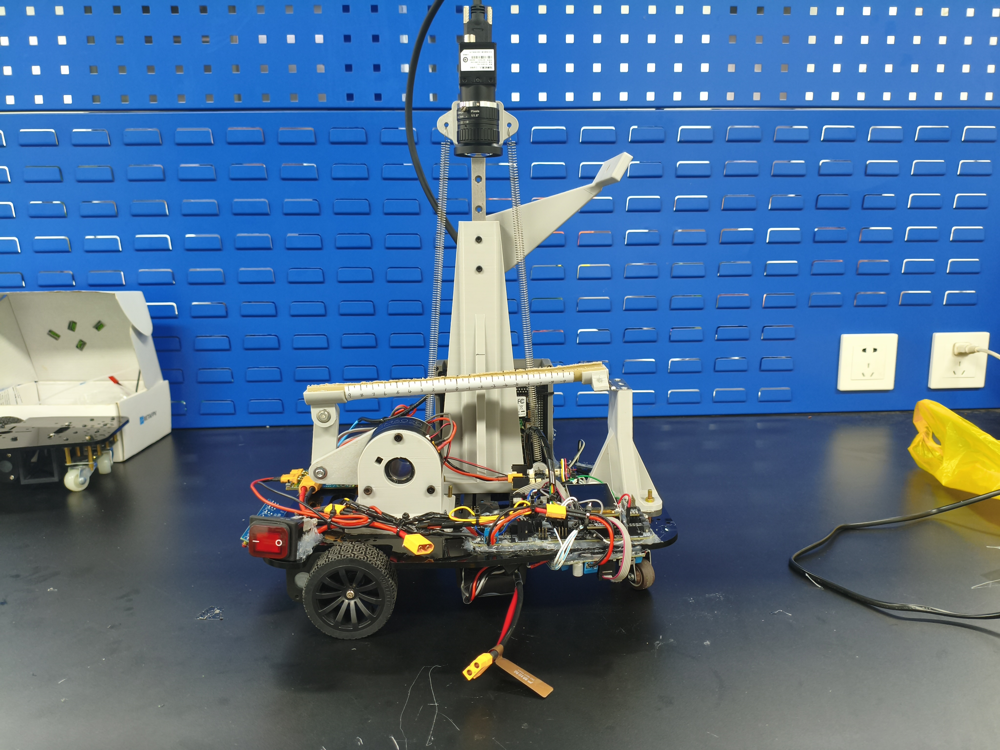
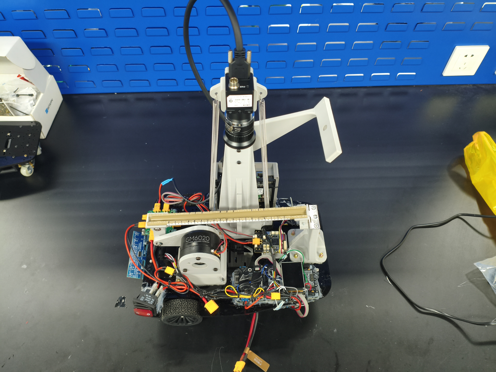
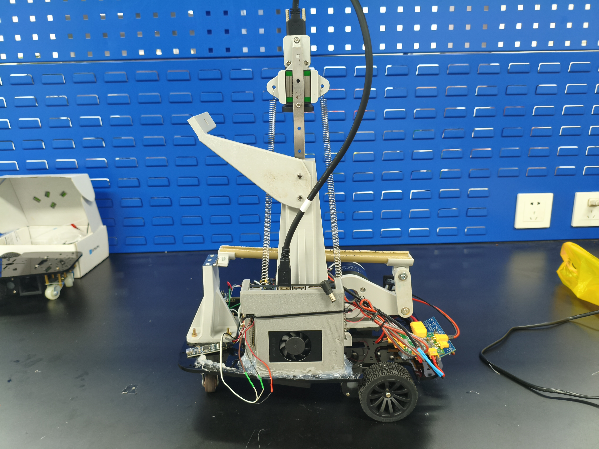
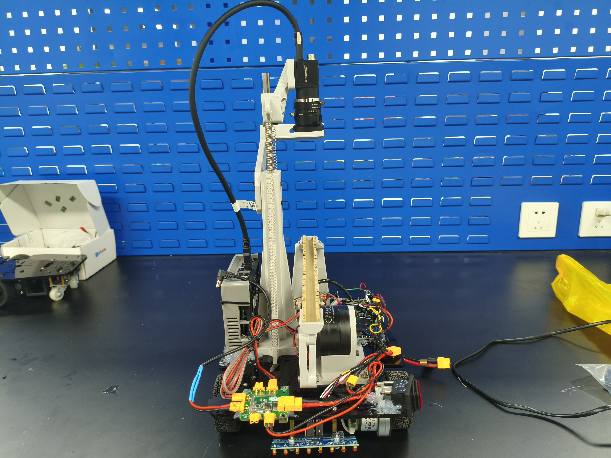

# 2026年全国大学生电子设计大赛（福建赛区）~~``遗憾省二代码库``~~

---

## 前言

> 欧玛吉利曼波，虽然牢卯肝了一个暑假，经历了惨无人道的四天三夜的磨练，但还是由于各种~~不确定因素~~(悲)，最后还是没能拿下省一😭😭😭，拖累了学长的大腿
>
>> 牢卯编写于26.08电赛期间
>>

这是牢卯在507梦到的仓库，主要分享了牢卯在26年电赛编写的H题底盘控制代码，希望对以后想要打电赛的同学带来一点帮助。~~(虽然对各位大佬来说，这个用vibe coding搓出来的产物可能很抽象（泣)~~

> 本仓库仅针对于H题(既控制题)发表一些粗糙的看法，不涉及其他题目，如若还想看其他题目的见解于代码，请敬请期待牢卯的第二次电赛 ~~`life is repeat`~~ (悲

---

### 一、模块化管理你的代码

古人云`life is repeated,but people are not the same.`，所以在准备电赛的时候，最好在七月份就把相应的模块代码都写好，因为电赛的赛程相当 ~~阴间~~ （只有四天三夜），这可以避免在比赛期间出现各种不必要的bug，毕竟电赛还是挺争分夺秒的。 ~~`卯小弟这四天没有一天是睡好的`~~

关于控制题，主要可能涉及到的模块有：

> 这里关于GPIO、I2C、SPI、UART等基础外设这里不再过多赘述，一些基本的开源库都有这些外设模块的封装，大家可以自行查阅

1. `光电传感器`：😈😈😈循迹使用，一般为灰度传感器，这也是老生常谈的传感器了，几乎各大平台上都有相应的资料教程。不过也有可能不同的赛区会规定一些比较阴间的传感器 ~~(说的就是你，红外传感器)~~ ，所以在比赛前最好了解清楚赛区的规定，看清赛前一周发布的器材清单。
2. `电机驱动`：对于控制（小车）题来说，电机是必不可少的，选择什么类型的电机很大程度上决定了底盘的性能。而常用的电机有两种，分为有刷和无刷。

   - `有刷电机`：有刷电机的优点是价格便宜，控制简单，缺点是寿命短，效率低，噪音大，当然也可配备减速齿轮使用来增大它的扭矩与丝滑程度，对于有刷电机，我习惯使用drv8701来进行驱动，简单且高效。今年的题目中，我使用了一对由drv8701驱动来控制的直流有刷电机来控制小车的行驶，效果还行，最起码不会出现像之前做智能车的时候那样的电机烧毁、转向环难以调整的情况 ~~`（N030是fvv，悲）`~~ ，所以说减速齿轮还是很有必要的😭😭😭，至少能让你的速度环调的不那么痛苦。
   - `无刷电机`：无刷电机的优点是寿命长，效率高，噪音小，缺点是价格贵，控制复杂。而无刷电机我暂时还没有使用经验，无刷在精细控制上也常使用，像今年26年H题我们就采用了大疆RM的一款无刷电机用于控制钢珠平衡 ~~`（是的，这里也有RM（悲，不过这部分就是另一个学长的作品了）`~~ 。
3. `电机控制算法`：有了电机我们当然可以开始直接控制小车向前向后，但是对于比赛中的复杂情况，仅仅实现向前向后是远远不够的，那么这个时候，我们就要开始实现对小车的两个闭环的控制，分别为`速度环`和`方向环`，而这两个闭环控制我们就需要通过一定的算法来实现，电机控制算法的性能直接影响到底盘的性能。一般来说，电机控制算法的选择有多种，这里列举做比赛时可能会用到的，当然还有很多是本菜鸡尚未知晓的 ~~（悲）~~ ：

   - `PID控制算法`：PID控制算法是一种经典的控制算法，适合大多数比赛使用，这种是最常用也是大部分人在简单控制系统中乐于使用的算法。
   - `LQR控制算法`：LQR是一种比较先进的控制算法，适合一些比较复杂场景控制的比赛使用`(belike:RM,RC...)`，当然本菜鸡暂无使用经验（悲）。

   当然关于这方面的算法资料，网上有特别多，这里不再一一赘述，主要说一下调车时会使用到PID的地方和使用结构。

   - `速度环`：速度环主要用于控制小车的速度，保证小车在不同的路况下都能保持稳定的速度输出。调试速度环时，需要注意以下几点：

     1. 确定目标速度：根据比赛要求和赛道情况，设定一个合理的目标速度。
     2. 调整PID参数：通过实验调整P、I、D参数，使小车在达到目标速度时能够快速响应且不产生过大的超调。
     3. 测试不同路况：在不同的赛道条件下测试速度环的表现，确保其在各种情况下都能稳定工作。
   - `方向环`：方向环主要用于控制小车的行驶方向，确保小车能够准确地沿着预定路线行驶。调试方向环时，需要注意以下几点：

     1. 确定目标方向：根据赛道设计和比赛要求，设定一个合理的目标方向。
     2. 调整PID参数：通过实验调整P、I、D参数，使小车在改变方向时能够快速响应且不产生过大的偏差。
     3. 测试不同转弯情况：在不同的转弯条件下测试方向环的表现，确保其在各种情况下都能稳定工作。

     > 在实际调车时，还请先调完速度环再来调整你的方向环，对于每一个不同的速度，也建议单独记录对应的方向环参数，毕竟不同的速度下，方向环的参数也会有所不同。
     >

   当然，调方向环的准则还是以小车的稳定性为第一要求，不然在比赛中可能会出现小车失控、车身抖动而影响其他控制部位等状况，从而导致比赛失败。

4. `编码器`：对于电机来说，编码器是一个非常重要的传感器，它可以实时反馈电机的转速和位置，从而为速度环和方向环提供必要的数据支持。可以说没有编码器，就完成不了小车的速度环与方向环的精确控制与调整。编码器的选择和使用也需要根据比赛要求和电机类型来决定。
>提醒：编码器的接线一定要注意AB相的顺序，不能与写的代码相反，轻则小车无法正常运行，重则可能会烧毁电机驱动以及电机。

5. `姿态传感器`：姿态传感器用于测量小车的倾斜角度和角速度，它可以帮助小车在行驶过程中保持稳定的姿态，尤其是在转弯和加速减速时。姿态传感器的数据可以与编码器的数据结合使用，从而实现更精确的速度环和方向环控制。而在实现方向环的基础之上，我们还可以使用姿态传感器的角度识别来进行小车的“硬”转弯控制，例如旋转固定角度等。总而言之，有姿态传感器能够大大的帮助我们提高对小车的控制精度和稳定性。
姿态传感器的选择需根据自身需求以及预算来确定，一般来说像这种实现小车控制的项目使用逐飞的IMU660RB即可很方便的读取旋转角度，该传感器采用的是ST意法半导体的芯片，详情参考逐飞的[IMU660RB产品介绍](https://www.seekfree.com.cn/%E4%BA%A7%E5%93%81%E8%B5%84%E6%96%99/%E4%BC%A0%E6%84%9F%E5%99%A8/%E5%A7%BF%E6%80%81%E4%BC%A0%E6%84%9F%E5%99%A8/imu660ra%E5%85%AD%E8%BD%B4%E6%A8%A1%E5%9D%97/)。
这款姿态传感器需要自己对输出姿态数据进行解算才能得到旋转角度的数据，不过在逐飞开源的项目中也有关于姿态解算的一些文章可以参考。
对于姿态传感器我们往往还需要在意它的零飘和温飘问题，这些问题都会影响我们对数据的获取分析与使用，往往很多惯导问题都是发生在未能正确处理好零飘下产生的，所以使用到的滤波算法也很重要！！！

以上为我在26年电赛小车控制中所使用到的所有模块，当然还有很多其他的模块可以使用，这里仅仅是我在比赛中所使用到的模块，供大家参考（其实我今年也没有用姿态传感器，因为今年H题的赛道比较简单，不需要使用`惯性导航`即可实现相对良好的控制效果）。

---
### 二、模式选择：通过按键来选择你要进行的模式

对于电赛这样的多题目设置的比赛，对你的程序设置一个按键菜单，然后在按键菜单上通过按键来进行题目选择还是很有必要的，这样能一定程度上解决比赛时手忙脚乱的问题，也能避免出现在赛场上出现不合理的违规操作。`（打开电脑进行现场烧录程序，这是绝对不允许的，在智能车中这是合理且正当的行为，但是在电赛中一经发现则0分处理！！！）`

---

### 三、按键调参 `肥肠重要`

在我们实际进行比赛中，拥有按键调参这样一个功能还是十分甚至九分有必要的，因为你根据赛题而定制的赛道地图和组委会那边提供的赛道地图还是有一定区别和差异的。如果没能设置按键调参功能，可能会因为速度环或者方向环未能实现正常功能而导致比赛失败，也有可能因为行程设置问题导致停车功能失败。总而言之，赛场上的条件和在学校实验室中使用的条件还是有所不同的，我们需要根据不同的环境，设定不同的参数。故而设置一个按键调参功能时相当有必要的。
>本蛆就是因为没有设置按键调参功能导致停车位置异常，然后有两题直接0分，最后遗憾省二的😭😭😭😭最后还是拖累了学长的大腿（悲）

---

最后的最后，感谢两位带我一起做电赛的学长，学长的视觉和平衡控制夯爆了😭😭😭，另一位学长的机械结构也夯爆了。如果不是两位学长带我一起做电赛，我可能到现在还没有一个属于自己的省奖（泣）~~`虽然是因为我的愚蠢操作导致省一(泣)变成的省二orz`~~也是因为学长的指导，我对小车控制以及比赛的理解才更加的深入了。
附上小车的照片几张（结构真的帅爆了）。

